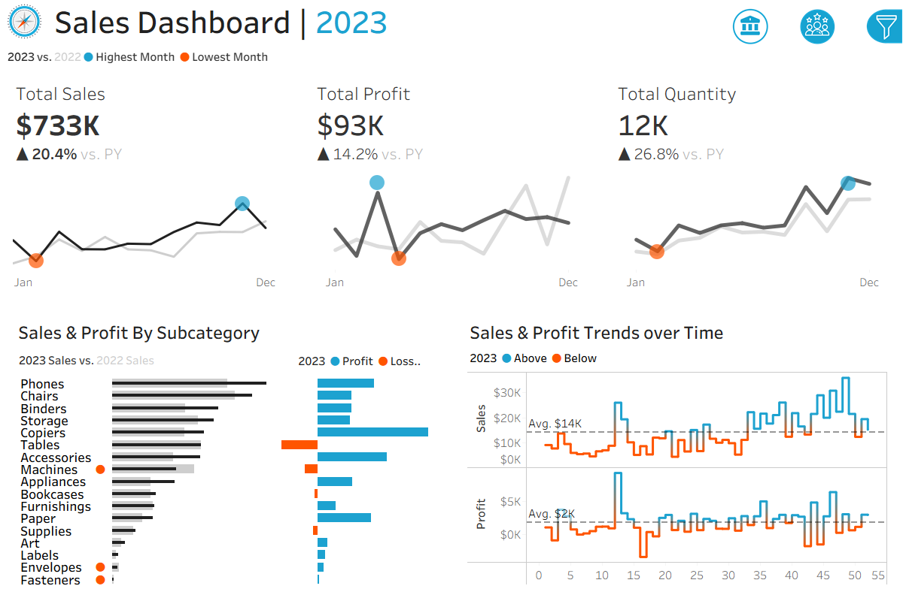
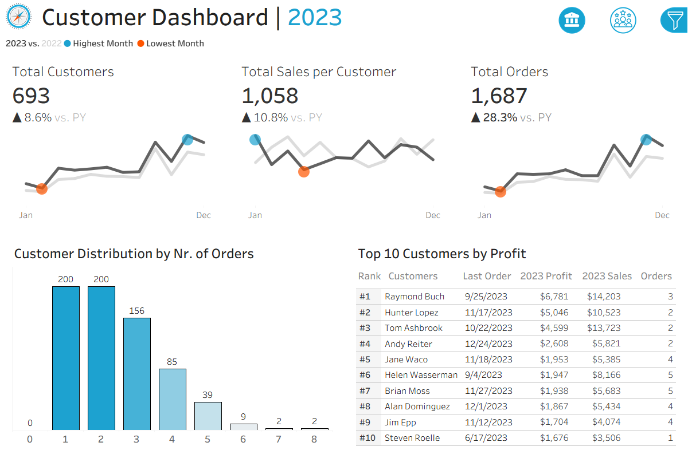
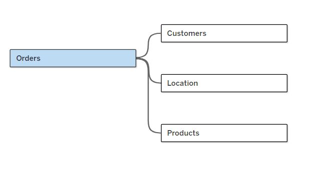
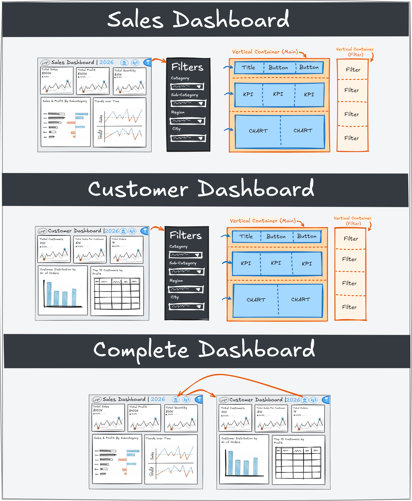

# Sales & Customer Analytics

An end-to-end Tableau business intelligence project featuring relational data modeling, dynamic KPI calculations, and interactive dashboards for analyzing sales performance, profitability, and customer behavior.

## 🔗 Live Demonstration

[Explore the Interactive Dashboards on Tableau Public](https://public.tableau.com/app/profile/cornelio.cardenas/viz/SalesCustomerDashboards_17955691438790/SalesDashboard)

## 📌 Project Overview

This project provides an interactive business intelligence solution designed to help managers and business stakeholders understand retail sales performance and customer purchasing behavior.

The solution consists of two interconnected Tableau dashboards supported by a relational data model, dynamic calculations, and interactive filtering capabilities.

## 🎯 Business Problem & Objectives

Understanding business performance requires more than monitoring total sales. Stakeholders need visibility into profitability, historical trends, product performance, and customer purchasing patterns to support informed decision-making.

The main objectives of this project are to:

- Monitor key sales, profitability, and customer metrics.
- Compare business performance across different years.
- Identify high-performing and underperforming product subcategories.
- Analyze monthly and weekly sales and profit trends.
- Understand customer purchasing frequency and identify high-value customers.
- Provide an interactive and centralized analytical experience.

## 📊 Dashboard Features

### Sales Dashboard

The Sales Dashboard provides a comprehensive overview of business performance through:

- Total sales, profit, and quantity KPIs.
- Dynamic year-over-year performance comparisons.
- Monthly trends with highlighted minimum and maximum values.
- Sales and profitability analysis by product subcategory.
- Weekly sales and profit trends with average reference lines.
- Interactive product and geographical filters.

### Customer Dashboard

The Customer Dashboard focuses on customer performance and purchasing behavior through:

- Total customers, sales per customer, and total orders.
- Dynamic year-over-year customer KPI comparisons.
- Monthly customer performance trends.
- Customer distribution by number of orders.
- Top 10 customers ranked by profitability.
- Customer-level sales, profit, order frequency, and last order date.

Both dashboards support dynamic year selection, interactive chart filtering, dashboard navigation, and an expandable filter panel.

## 📈 Project Results

The following metrics were obtained from the 2023 dataset, compared against 2022.

| Metric | 2023 Result | YoY Change |
|---|---:|---:|
| Total Sales | $733K | +20.4% |
| Total Profit | $93K | +14.2% |
| Total Quantity | 12K | +26.8% |
| Total Customers | 693 | +8.6% |
| Sales per Customer | $1,058 | +10.8% |
| Total Orders | 1,687 | +28.3% |

### Key Business Insights

- **Sales growth:** Total sales increased by 20.4%, while total quantity increased by 26.8%, indicating strong growth in sales volume.
- **Profitability:** Profit increased by 14.2%, below the sales growth rate, indicating potential pressure on profit margins.
- **Product performance:** Copiers generated the highest profit among product subcategories, while Tables generated the largest loss.
- **Customer engagement:** Total orders increased by 28.3%, significantly outperforming customer growth of 8.6%, indicating higher purchasing frequency.
- **Customer retention opportunity:** Approximately 58% of customers placed only one or two orders during 2023, highlighting a potential opportunity to encourage repeat purchases.

These findings represent historical performance within the project dataset, rather than business improvements resulting from the dashboard implementation.

## 📁 Dataset & Data Model

The project uses four CSV datasets containing retail sales transactions, customer information, product details, and geographical information.

| Dataset | Description | Table Type |
|---|---|---|
| Orders.csv | Sales transactions, order dates, quantities, sales, and profits | Fact |
| Customers.csv | Customer identifiers and names | Dimension |
| Products.csv | Product identifiers, names, categories, and subcategories | Dimension |
| Location.csv | Postal codes, cities, states, and regions | Dimension |

### Data Model

The data model follows a star-schema-style structure implemented using Tableau's logical relationships, with Orders as the central fact table connected to three dimensions.

Relationships are established through:

- Orders → Customers: Customer ID
- Orders → Products: Product ID
- Orders → Location: Postal Code

This structure supports multidimensional analysis across customers, products, geographical locations, and time.

## ⚙️ Methodology

### 1. Requirements Analysis & Design

Defined the analytical requirements, selected appropriate visualization types, and designed the initial dashboard mockup using Excalidraw.

### 2. Data Preparation & Modeling

Connected the CSV datasets, established logical relationships, reviewed data types, and explored the available dimensions and measures.

### 3. Calculations & Visualization Development

Developed calculated fields, dynamic parameters, and visualizations to support:

- Current-year and previous-year metrics.
- Year-over-year percentage changes.
- Minimum and maximum monthly values.
- Sales and profit performance against weekly averages.
- Customer purchasing frequency.
- Customer profitability rankings.

### 4. Dashboard Development

Organized visualizations using dashboard containers and implemented coordinated filters, dynamic parameters, navigation buttons, customized tooltips, and consistent visual formatting.

The completed solution was published to Tableau Public for interactive exploration.

## 🛠️ Technology Stack

- **Business Intelligence:** Tableau Desktop, Tableau Public
- **Data Modeling:** Dimensional Modeling, Tableau Relationships
- **Data Analysis:** Tableau Calculated Fields, Table Calculations, Parameters
- **Data Sources:** CSV
- **Dashboard Design:** Excalidraw
- **Version Control:** GitHub

## 🚀 Installation & Usage

### Online

Access the interactive solution directly through [Tableau Public](https://public.tableau.com/app/profile/cornelio.cardenas/viz/SalesCustomerDashboards_17955691438790/SalesDashboard).

### Local

1. Download or clone this repository.
2. Open the `dashboards/` directory.
3. Open `sales-customer-analytics.twbx` using a compatible version of Tableau Desktop or Tableau Public Edition.
4. Select the desired year and explore the dashboards using the available filters.

The `.twbx` file contains the packaged workbook and its included data resources, while the `.twb` file provides the original workbook definition for technical inspection and further development.

## 👤 Author

**Cornelio Cardenas**

BI & Data Engineer | Data Integration, Analytics & Automation

[LinkedIn](https://www.linkedin.com/in/cornelio-cardenas/)
